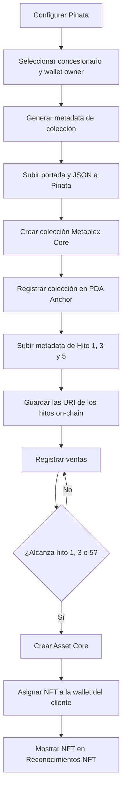
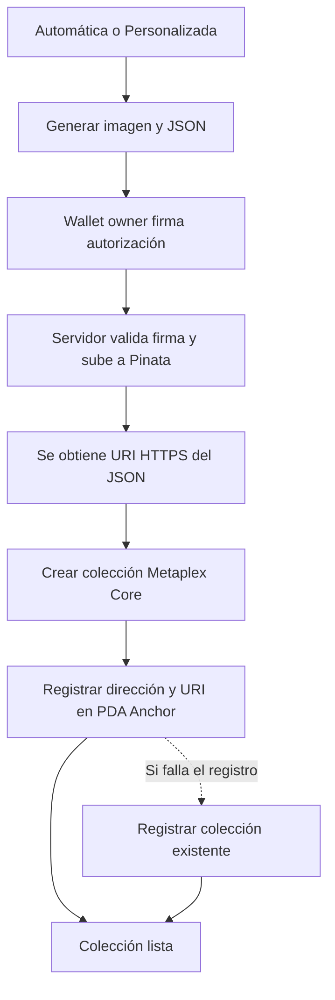
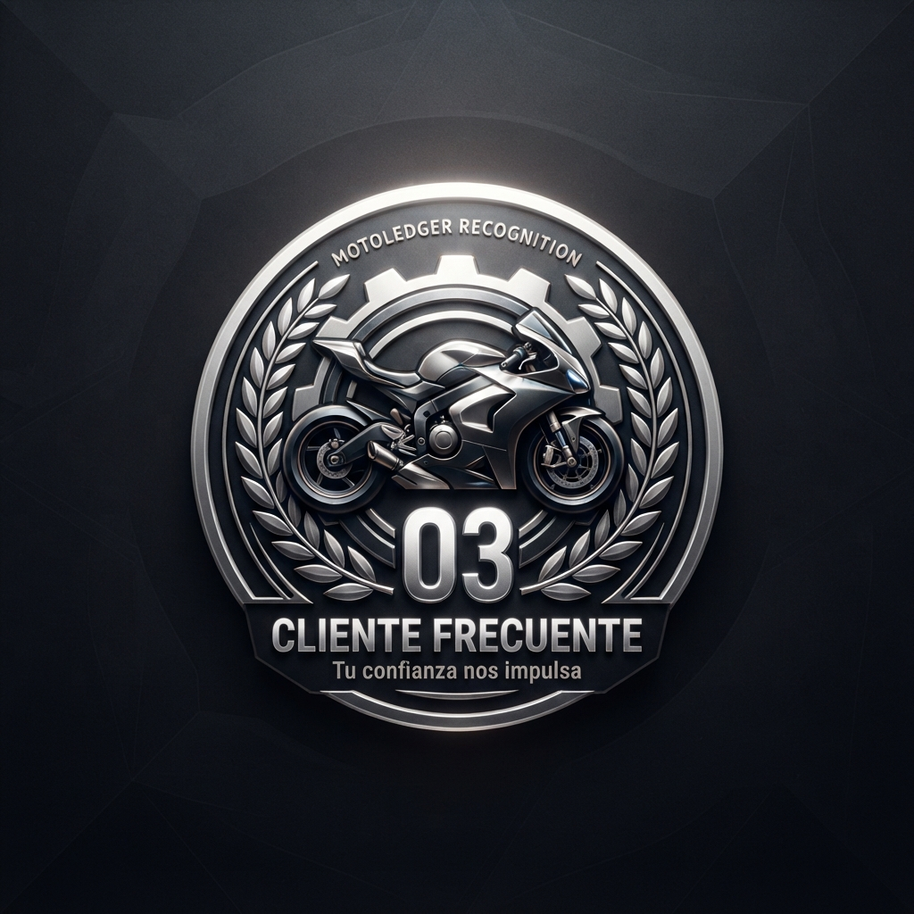
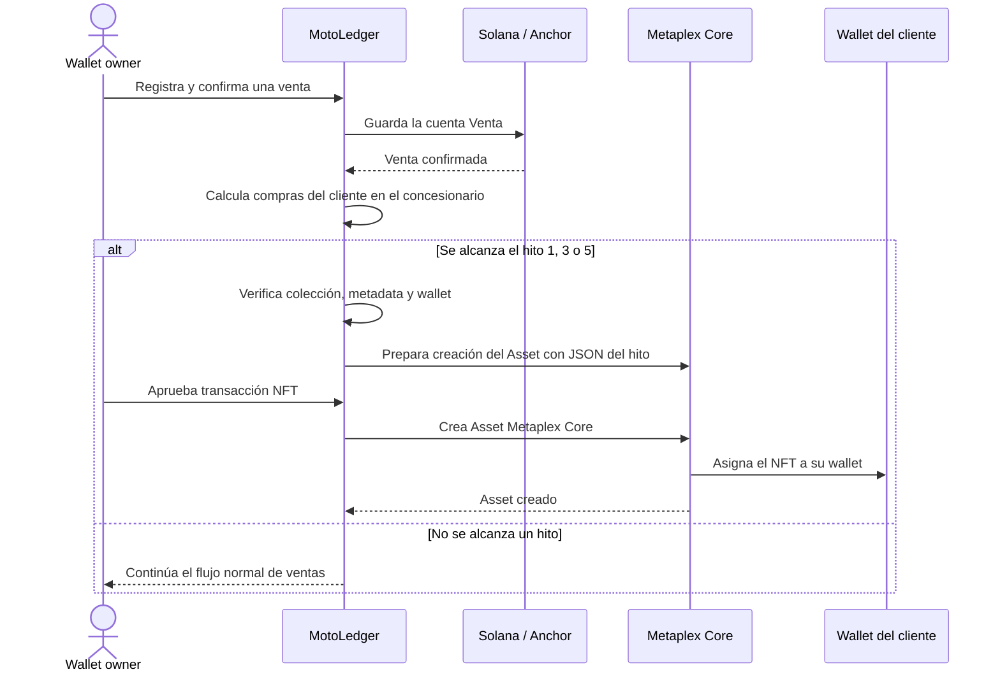

# MotoLedger — Reconocimientos NFT con Metaplex Core

MotoLedger registra las ventas de cada concesionario en **Solana** y reconoce la fidelidad de sus clientes mediante NFT creados con **Metaplex Core**. Los reconocimientos se activan al alcanzar **1, 3 y 5 compras dentro del mismo concesionario**.

Este repositorio documenta el flujo de colecciones Core, publicación de metadata en Pinata/IPFS y emisión de Assets NFT. La fidelización mediante Token-2022 es complementaria y no forma parte del flujo principal explicado aquí.

<p align="center">
  
</p>

> **Red de demostración:** Solana Devnet  
> **Programa Anchor:** [64dHKqRTBciEidqLJqCvTWEGWkR1QqyYDZgomMt9AWCj](https://explorer.solana.com/address/64dHKqRTBciEidqLJqCvTWEGWkR1QqyYDZgomMt9AWCj?cluster=devnet)  
> **Aplicación:** [MotoLedger](https://moto-ledger-token-2022.vercel.app/)

---

## Índice

- [Cómo funciona](#cómo-funciona-el-proceso-completo)
- [Requisitos previos](#requisitos-previos)
- [Configurar Pinata](#1-configurar-pinata)
- [Crear la colección automáticamente](#2-generar-la-metadata-y-crear-la-colección-core)
- [Cargar metadata de los tres hitos](#3-subir-la-metadata-de-los-tres-hitos)
- [Emisión automática de NFT](#4-emisión-automática-al-alcanzar-un-hito)
- [Emitir reconocimientos históricos](#5-procesar-reconocimientos-pendientes)
- [Imágenes de los hitos](#colección-visual-de-los-tres-hitos)
- [Qué queda on-chain y qué queda en IPFS](#qué-se-guarda-en-solana-y-qué-se-guarda-en-ipfs)
- [Ejecución local](#ejecución-local)
- [Evidencia Devnet](#evidencia-devnet)
- [Seguridad y límites](#seguridad-y-límites)

## Cómo funciona el proceso completo

Cada concesionario administra **una colección Metaplex Core propia**. Esa colección agrupa los NFT de sus clientes. La portada y la metadata de la colección son independientes de las imágenes y metadata de cada hito.

El proceso tiene cuatro etapas:

1. **Preparar Pinata:** configurar el JWT privado y el gateway público.
2. **Crear la colección:** generar automáticamente su metadata, subirla a IPFS, crear la colección Core y registrar su dirección en la PDA del concesionario.
3. **Configurar los hitos:** subir los tres JPG y sus JSON a Pinata y guardar las URI de metadata en Solana.
4. **Emitir reconocimientos:** al completarse una venta que alcanza un hito, crear un Asset Core y asignarlo a la wallet vinculada del cliente. Los hitos anteriores a la configuración se pueden emitir desde el módulo de pendientes.

### Diagrama general



> **Importante:** crear la colección no emite por sí solo los NFT de los clientes. Primero se crea y registra la colección; después se configuran las metadata de los hitos. Cada NFT se crea cuando una venta alcanza un hito o cuando se procesa un reconocimiento pendiente.

## Requisitos previos

Antes de iniciar la configuración, asegúrate de tener:

- Una wallet Solana compatible conectada a MotoLedger.
- La wallet **owner** autorizada para administrar el concesionario.
- El concesionario registrado y seleccionado en el dashboard.
- SOL de Devnet para pagar las comisiones y la creación de cuentas durante las pruebas.
- Una cuenta de [Pinata](https://www.pinata.cloud/) con un JWT y un gateway público configurado.
- La wallet del cliente vinculada en MotoLedger para que pueda recibir su NFT.

Los hitos se cuentan por la combinación **concesionario + cliente**. Una compra en otro concesionario no incrementa el progreso de este concesionario.

## 1. Configurar Pinata

La aplicación sube a Pinata los archivos de imagen y sus documentos JSON. La carga se realiza desde una ruta del servidor; la wallet owner firma un mensaje para autorizar la operación.

Configura estas variables en el entorno de despliegue (por ejemplo, Vercel → Project Settings → Environment Variables) y en `.env.local` cuando trabajes localmente:

```env
PINATA_JWT=tu_jwt_privado_de_pinata
NEXT_PUBLIC_GATEWAY_URL=https://tu-gateway.mypinata.cloud
```

| Variable | Uso | Exposición |
| --- | --- | --- |
| `PINATA_JWT` | Autoriza las cargas a Pinata desde el servidor. | **Privada. Nunca usar el prefijo `NEXT_PUBLIC_`.** |
| `NEXT_PUBLIC_GATEWAY_URL` | Gateway HTTPS público para resolver los CID de IPFS. | Pública. |

**Pasos en Pinata:**

1. Crea o selecciona tu cuenta en Pinata.
2. Genera un JWT con permisos suficientes para cargar archivos.
3. Copia el JWT en `PINATA_JWT`.
4. Configura el gateway público y coloca su dominio HTTPS en `NEXT_PUBLIC_GATEWAY_URL`.
5. Guarda las variables y reinicia el servidor o realiza un nuevo deployment para que sean aplicadas.

La aplicación genera URI HTTPS con el gateway y la ruta `/ipfs/<CID>`. No introduzcas el JWT en el frontend, en el JSON público ni en el repositorio. Las URI que se guardan en Solana deben apuntar al JSON público, no a una página de administración de Pinata.

## 2. Generar la metadata y crear la colección Core

Esta operación se realiza una sola vez por concesionario, salvo que se esté recuperando el registro de una colección que ya fue creada.

En el dashboard:

1. Conecta la wallet owner y selecciona el concesionario correcto.
2. Abre **Reconocimientos NFT**.
3. En el bloque de configuración de colección, si todavía no existe una colección registrada, encontrarás el apartado **Metadata de la colección**.
4. Mantén seleccionada la opción **Automática**.
5. Pulsa **Generar y subir metadata**.
6. Aprueba desde tu wallet la firma del mensaje de autorización.
7. Espera la confirmación de Pinata. La aplicación completará la URL HTTPS del JSON en el campo de metadata.
8. Pulsa **Crear colección Core** y aprueba la transacción en tu wallet.
9. MotoLedger crea la colección Metaplex Core y, a continuación, registra su dirección en la cuenta Anchor `ReconocimientoColeccion`.

### ¿Qué hace la opción Automática?

La opción automática consulta los datos públicos del concesionario almacenados en Solana y prepara una portada PNG de 1024 × 1024 junto con su JSON:

| Campo | Generación automática |
| --- | --- |
| Nombre | Nombre del concesionario + `Reconocimientos #ID` |
| Símbolo | `ML` + ID del concesionario |
| Descripción | Describe la colección oficial y los hitos de fidelidad |
| Imagen | Portada generada por MotoLedger con el nombre e ID del concesionario |
| Almacenamiento | Imagen y JSON públicos en Pinata/IPFS |

La opción **Personalizada** permite introducir nombre, símbolo, descripción y seleccionar una imagen PNG, JPG o WEBP. En cualquiera de los dos modos, la wallet owner autoriza la carga.

### Crear la colección en Solana

El botón **Crear colección Core** utiliza el JSON HTTPS recién subido para crear la colección Metaplex Core. Luego el frontend envía una instrucción Anchor para guardar:

- La dirección de la colección Core.
- La URI de metadata de la colección.
- La relación con el concesionario y la wallet owner.

La creación de la colección Core y el registro Anchor son dos transacciones/operaciones diferenciadas. **Si la colección Core se creó pero falló el registro Anchor, no vuelvas a crear otra colección.** Copia la dirección existente, utiliza el apartado de recuperación/registro de colección existente y vuelve a registrar esa misma dirección.



## 3. Subir la metadata de los tres hitos

Una vez registrada la colección, aparecerá el bloque **METADATA IPFS · Imágenes de los hitos**. Cada hito tiene su propia imagen JPG y su propio JSON público en Pinata. No se comparte el JSON entre hitos: cada NFT debe apuntar a la metadata que representa su reconocimiento.

<p align="center">
  
  
  
</p>

| Hito | Nombre | Significado |
| --- | --- | --- |
| **1** | **PRIMERA COMPRA** | Reconoce la primera compra registrada por el cliente en ese concesionario. |
| **3** | **CLIENTE FRECUENTE** | Reconoce que el cliente alcanzó tres compras en el mismo concesionario. |
| **5** | **CLIENTE DESTACADO** | Reconoce que el cliente alcanzó cinco compras en el mismo concesionario. |

### Opción A — Subir los tres hitos juntos

Es la forma recomendada para una primera configuración:

1. Revisa las tres tarjetas de hito.
2. Si quieres usar las imágenes incluidas en el repositorio, no necesitas seleccionar archivos: MotoLedger usa por defecto `assets/recognitions/milestone-1.jpg`, `milestone-3.jpg` y `milestone-5.jpg`.
3. Si deseas imágenes propias, selecciona un archivo JPG en la tarjeta correspondiente.
4. Pulsa **Subir los tres hitos**.
5. Firma con la wallet owner cada autorización solicitada.
6. La aplicación carga las imágenes y los JSON de los hitos que necesiten actualizarse, y finalmente guarda las tres URI de metadata en la PDA Anchor.

El proceso conserva las metadata existentes cuando no necesitan reemplazarse. Si seleccionas una imagen nueva para un hito, se vuelve a generar y subir la metadata de ese hito.

### Opción B — Subir un hito individual

Utiliza **Subir solo este hito** en la tarjeta correspondiente cuando quieras configurar o reemplazar únicamente una imagen:

1. Selecciona un JPG si deseas sustituir la imagen predeterminada.
2. Pulsa **Subir solo este hito**.
3. Firma el mensaje de autorización con la wallet owner.
4. MotoLedger sube la imagen y su JSON a Pinata.
5. La aplicación actualiza la URI de ese hito en la PDA Anchor, conservando las URI de los otros dos.

### ¿Qué debes comprobar en cada tarjeta?

- La vista previa debe mostrar la imagen que se utilizará para ese hito.
- El estado debe indicar **Metadata configurada** después de completar la carga.
- **Ver JSON en IPFS** debe abrir el documento público del hito.
- Si necesitas sustituir una imagen, selecciona el nuevo JPG antes de pulsar el botón de carga.

| Tarjeta | JSON independiente | Asset que utilizará al emitir |
| --- | --- | --- |
| Hito 1 · PRIMERA COMPRA | JSON propio en Pinata | URI del Hito 1 |
| Hito 3 · CLIENTE FRECUENTE | JSON propio en Pinata | URI del Hito 3 |
| Hito 5 · CLIENTE DESTACADO | JSON propio en Pinata | URI del Hito 5 |

### Estructura conceptual de metadata

Cada JSON público referencia su imagen mediante `image`. La estructura es compatible con metadata NFT y contiene, entre otros, nombre, símbolo, descripción, archivos y atributos:

```json
{
  "name": "PRIMERA COMPRA",
  "symbol": "ML-HITO-1",
  "description": "El comienzo de una gran relación",
  "image": "https://tu-gateway.mypinata.cloud/ipfs/<IMAGE_CID>",
  "properties": {
    "files": [
      {
        "uri": "https://tu-gateway.mypinata.cloud/ipfs/<IMAGE_CID>",
        "type": "image/jpeg"
      }
    ]
  },
  "attributes": [
    { "trait_type": "Hito", "value": 1 },
    { "trait_type": "Plataforma", "value": "MotoLedger" }
  ]
}
```

> El ejemplo es ilustrativo. Los CID reales son generados por Pinata durante la carga. Los datos privados del cliente y los detalles de la venta no se publican en estos JSON.

## 4. Emisión automática al alcanzar un hito

Una vez que la colección está registrada, las tres metadata están guardadas en Solana y el cliente tiene una wallet destinataria vinculada, MotoLedger puede emitir los reconocimientos durante el flujo normal de ventas.

### Condiciones para emitir

- La venta debe pertenecer al concesionario seleccionado.
- El cliente debe alcanzar exactamente uno de los hitos configurados: 1, 3 o 5 compras.
- El cliente debe tener una wallet destinataria asociada.
- La colección Core debe estar registrada para ese concesionario.
- La URI de metadata del hito correspondiente debe estar configurada.
- El reconocimiento no debe existir previamente para ese cliente, concesionario e hito.

### ¿Qué ocurre cuando se confirma una venta?

1. El owner registra y confirma la venta desde el módulo **Ventas**.
2. MotoLedger actualiza el progreso del cliente contando sus ventas en ese concesionario.
3. Si la venta completa el hito 1, 3 o 5, la aplicación obtiene la metadata correspondiente.
4. Se prepara la creación de un Asset Metaplex Core con los Attributes del reconocimiento.
5. La wallet owner aprueba la transacción de emisión.
6. El NFT queda asignado a la wallet vinculada del cliente y aparece en el historial de **Reconocimientos NFT**.



**La venta y la emisión NFT son operaciones separadas.** La venta queda registrada primero. Si la transacción de Metaplex Core falla, la venta no se revierte; el reconocimiento se puede recuperar desde **Reconocimientos NFT → Clientes que ya alcanzaron un hito**.

La emisión automática se refiere a que MotoLedger detecta el hito y prepara el NFT dentro del flujo de ventas. La transacción de creación del Asset sigue requiriendo la aprobación de la wallet owner.

## 5. Procesar reconocimientos pendientes

Este módulo también permite reconocer compras que ocurrieron antes de crear la colección o antes de cargar la metadata.

1. Abre **Reconocimientos NFT** con la wallet owner y el concesionario correcto.
2. Revisa el bloque **Clientes que ya alcanzaron un hito**.
3. MotoLedger calcula los hitos a partir de las cuentas `Venta` históricas de ese concesionario.
4. Comprueba cuáles ya tienen un Asset y cuáles siguen pendientes.
5. Para emitir uno, pulsa **Emitir reconocimiento** en la fila del cliente.
6. Para procesar todos los que estén listos, pulsa **Emitir todos los disponibles** y aprueba las transacciones solicitadas por la wallet.

Un reconocimiento está listo cuando el cliente tiene wallet destinataria y el hito tiene una URI de metadata configurada. Los clientes sin wallet o hitos sin metadata permanecen pendientes hasta completar esos requisitos.

Antes de emitir, MotoLedger vuelve a consultar la colección para evitar duplicados. Los Assets ya existentes se omiten durante el procesamiento por lote.

## Colección visual de los tres hitos

Las imágenes iniciales están versionadas en `assets/recognitions/`:

| Archivo | Uso |
| --- | --- |
| `milestone-1.jpg` | Primera compra |
| `milestone-3.jpg` | Cliente frecuente |
| `milestone-5.jpg` | Cliente destacado |

Se pueden reemplazar desde el selector de archivos de cada tarjeta. La aplicación usa los JPG del repositorio como valores predeterminados cuando no se selecciona una imagen personalizada.

## Qué se guarda en Solana y qué se guarda en IPFS

| Componente | Datos / responsabilidad |
| --- | --- |
| **Programa Anchor** | Mantiene la PDA `ReconocimientoColeccion` con owner, concesionario, dirección de colección y URI de metadata de colección e hitos. |
| **Metaplex Core Collection** | Representa la colección del concesionario y referencia la metadata pública de colección. |
| **Metaplex Core Asset** | Representa cada reconocimiento NFT. Su owner es la wallet del cliente. |
| **Attributes del Asset** | Relacionan el hito, la PDA del cliente, la PDA del concesionario y la PDA de la venta. |
| **Pinata / IPFS** | Aloja la portada, las imágenes de hitos y sus documentos JSON públicos. |
| **MotoLedger** | Calcula el progreso, detecta hitos, revisa Assets existentes y prepara las transacciones. |

### PDA de configuración

La cuenta Anchor `ReconocimientoColeccion` es la fuente de verdad de la asociación entre concesionario y colección.

- **Seeds:** `[b"reconocimiento_coleccion", concesionario_pubkey]`.
- **Campos principales:** owner, concesionario, dirección de colección Core, URI de metadata de colección, URI de metadata de hitos 1/3/5 y bump.
- **`registrar_coleccion_reconocimientos`:** registra la colección Core en la PDA del concesionario.
- **`actualizar_metadata_reconocimientos`:** actualiza las URI de metadata sin reemplazar la dirección de colección.
- **Autorización:** las instrucciones requieren la firma de la wallet owner.

### Configuración de los Assets

Cada Asset se crea con:

- La colección Core del concesionario.
- La URI JSON del hito alcanzado.
- La wallet del cliente como owner.
- Un plugin `Attributes` con los campos `hito`, `cliente`, `concesionario` y `venta`.
- El plugin `PermanentFreezeDelegate` con `frozen: true` y la autoridad de actualización de la colección.

El cliente conserva la propiedad del NFT, pero no la autoridad de congelamiento.

## Alcance y consideraciones técnicas

- El progreso se calcula con las cuentas `Venta` del mismo concesionario y cliente; no utiliza el contador global del cliente.
- La aplicación consulta los Assets Core para evitar emitir dos veces el mismo reconocimiento.
- La venta se confirma primero; la emisión Core se realiza en una transacción posterior.
- Los reconocimientos históricos se pueden emitir individualmente o en lote.
- La comprobación de hitos y duplicados se realiza en el frontend en esta versión; no es una restricción anti-fraude impuesta por el programa Anchor.
- El programa Anchor registra la dirección de colección y las URI, pero no deserializa ni verifica internamente el estado Metaplex Core. El frontend verifica la colección antes del registro.
- La wallet con autoridad de actualización de la colección podría crear Assets fuera del dashboard. Una garantía anti-fraude más estricta requeriría validaciones y recibos únicos adicionales en el programa.

## Probar la aplicación en Devnet

1. Abre [MotoLedger](https://moto-ledger-token-2022.vercel.app/).
2. Selecciona **Solana Devnet** y conecta la wallet owner de un concesionario de demostración.
3. En **Reconocimientos NFT**, genera y sube la metadata de colección con la opción **Automática**.
4. Pulsa **Crear colección Core** y aprueba la creación y el registro.
5. Sube los tres hitos con **Subir los tres hitos**.
6. Revisa los clientes con ventas históricas y emite pendientes, si los hay.
7. Registra una venta que complete un hito para probar la detección y emisión desde el flujo de ventas.
8. Comprueba el NFT en **Reconocimientos emitidos** y abre el Asset en Solana Explorer.

La wallet owner necesita SOL de Devnet para las comisiones y la creación de cuentas. La wallet destinataria del cliente debe estar vinculada antes de la emisión.

## Ejecución local

Requisitos: Node.js 24 o superior, npm y una wallet compatible con Solana.

```bash
git clone https://github.com/neocarvajal/moto-ledger-nfts-metaplex-core.git
cd moto-ledger-nfts-metaplex-core
npm install
```

Configura las variables de Pinata descritas anteriormente en `.env.local` y ejecuta:

```bash
npm run dev
```

Abre [http://localhost:3000](http://localhost:3000).

Comprobaciones disponibles:

```bash
npm run typecheck
npm run lint
npm run test
npm run build
```

## Evidencia Devnet

Añade aquí las direcciones y firmas de la colección y de los Assets NFT de la demostración cuando estén verificadas. No presentes transacciones de Token-2022 como evidencia de emisión NFT.

| Evidencia | Estado |
| --- | --- |
| Programa MotoLedger | [Ver programa en Solana Explorer](https://explorer.solana.com/address/64dHKqRTBciEidqLJqCvTWEGWkR1QqyYDZgomMt9AWCj?cluster=devnet) |
| Colección Metaplex Core | Pendiente de añadir la dirección real. |
| Asset NFT de reconocimiento | Pendiente de añadir la dirección real y sus Attributes. |
| Venta con emisión automática | Pendiente de añadir la firma de la transacción. |
| Emisión desde reconocimientos pendientes | Pendiente de añadir la firma y el Asset correspondiente. |

**Diseño técnico:** [docs/metaplex-core-recognition-design.md](docs/metaplex-core-recognition-design.md).

## Seguridad

- No incluyas claves privadas, frases semilla ni tokens JWT de Pinata en el repositorio.
- No publiques datos personales de los clientes en los JSON de metadata.
- La wallet owner debe revisar y aprobar las transacciones que administra.
- Las URI de metadata e imágenes son públicas y pueden ser consultadas por cualquier persona que conozca su dirección.
- Solana es la fuente de verdad para las ventas, la asociación de la colección y los Assets NFT.
