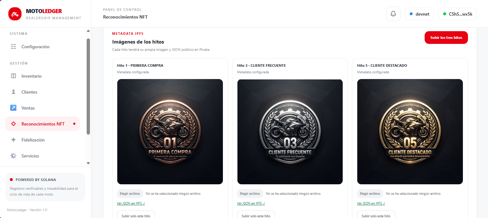

# MotoLedger — Reconocimientos NFT con Metaplex Core

MotoLedger registra ventas de concesionarios en **Solana Devnet** y reconoce la fidelidad de sus clientes mediante NFT. Cada reconocimiento es un Asset de **Metaplex Core** emitido al alcanzar los hitos de **1, 3 y 5 compras** en un mismo concesionario.

El foco de este proyecto es la creación y administración de colecciones Core y la emisión de reconocimientos NFT. La fidelización mediante Token-2022 es complementaria y no forma parte del flujo principal documentado aquí.

<p align="center">
  
</p>

> **Red:** Solana Devnet  
> **Programa Anchor:** [64dHKqRTBciEidqLJqCvTWEGWkR1QqyYDZgomMt9AWCj](https://explorer.solana.com/address/64dHKqRTBciEidqLJqCvTWEGWkR1QqyYDZgomMt9AWCj?cluster=devnet)  
> **Aplicación:** [moto-ledger-token-2022.vercel.app](https://moto-ledger-token-2022.vercel.app/)

## Flujo de reconocimientos NFT

1. **Registrar las ventas.** El concesionario registra las compras de sus clientes. Cada venta queda almacenada en Solana mediante la cuenta `Venta`.
2. **Calcular el progreso.** La aplicación consulta las ventas que pertenecen al mismo par concesionario/cliente. El progreso es independiente para cada concesionario; no utiliza el contador global del cliente.
3. **Configurar la colección.** El concesionario crea una colección Metaplex Core y registra su dirección y metadata en la PDA `ReconocimientoColeccion`.
4. **Preparar los hitos.** Se cargan las imágenes y los JSON de metadata para los reconocimientos de primera compra, cliente frecuente y cliente destacado.
5. **Preparar la emisión.** La colección Core debe estar registrada en la PDA del concesionario, las URI de metadata de los hitos deben estar guardadas en Solana y el cliente debe tener una wallet destinataria vinculada.
6. **Emitir automáticamente.** Al confirmar una venta que completa el hito 1, 3 o 5, MotoLedger registra primero la venta (y la recompensa Token-2022, si aplica). Después envía una transacción independiente para crear el Asset Core y asignarlo a la wallet del cliente.
7. **Procesar el histórico.** El módulo **Reconocimientos NFT** compara las ventas acumuladas con los Assets de la colección. Permite emitir los reconocimientos pendientes individualmente o en lote, incluidos los hitos alcanzados antes de configurar la colección.
8. **Consultar el historial.** El dashboard muestra el progreso, los pendientes, los NFT emitidos y los enlaces a Solana Explorer.

La emisión NFT es independiente de la confirmación de la venta: si Core falla, la venta permanece registrada y el reconocimiento queda pendiente para reintentar desde **Reconocimientos NFT**. Los hitos históricos pueden procesarse después de configurar la colección y la metadata.

## Hitos y colección visual

Cada concesionario tiene su propia colección. Los reconocimientos disponibles son:

<table>
  <tr>
    <td align="center">
      
      <br><strong>Hito 1 · Primera compra</strong>
    </td>
    <td align="center">
      
      <br><strong>Hito 3 · Cliente frecuente</strong>
    </td>
    <td align="center">
      
      <br><strong>Hito 5 · Cliente destacado</strong>
    </td>
  </tr>
</table>

Las tres imágenes JPG anteriores se incluyen como recursos iniciales en `assets/recognitions/`. La aplicación las utiliza por defecto y permite sustituirlas por otras imágenes JPG.

## Configuración de la colección

Desde **Reconocimientos NFT**, la wallet owner selecciona el concesionario y prepara la metadata de su colección:

- **Automática:** genera nombre, símbolo, descripción y portada a partir de la información del concesionario.
- **Personalizada:** permite cargar una imagen e introducir el nombre, símbolo y descripción.

Al generar la metadata, la wallet owner autoriza la carga mediante una firma. El servidor verifica la firma y la propiedad del concesionario antes de subir los archivos a Pinata. Después, la wallet owner crea la colección Metaplex Core y registra su dirección en el programa Anchor.

Se crea una colección por concesionario. La colección y los tres hitos utilizan metadata independiente. La creación de la colección Core y su registro en Anchor son operaciones separadas: si la colección se crea pero falla el registro on-chain, se debe reintentar el registro con la misma dirección de colección, no crear otra.

### Estado de la colección en Solana

La cuenta Anchor `ReconocimientoColeccion` es la fuente de verdad para la asociación entre concesionario y colección.

- **PDA:** semillas `[b"reconocimiento_coleccion", concesionario_pubkey]`.
- **Campos:** owner, PDA del concesionario, dirección de la colección Core, URI de metadata de la colección, URI de metadata de los hitos 1/3/5 y bump.
- **`registrar_coleccion_reconocimientos`:** crea la PDA y registra la colección existente.
- **`actualizar_metadata_reconocimientos`:** actualiza la URI de metadata de la colección y las URI de los tres hitos, sin reemplazar la dirección de colección.
- **Permisos:** ambas instrucciones requieren la firma de la wallet owner del concesionario.

El frontend consulta esta PDA para recuperar la configuración, por lo que cambiar de navegador o dispositivo no debe perder la asociación. El almacenamiento local, si se utiliza como caché, no sustituye el estado on-chain.

El programa Anchor comprueba que la cuenta de colección exista y valida la autorización del owner, pero en esta versión no deserializa ni verifica internamente que la cuenta pertenezca al programa Metaplex Core. Esa comprobación corresponde al frontend antes de registrar la dirección.

## Metadata e IPFS

Las imágenes y los documentos JSON se almacenan fuera de la cadena en Pinata/IPFS. En Solana se guardan sus URI HTTPS.

Cada metadata de hito incluye `name`, `symbol`, `description`, `image`, `properties.files` y atributos descriptivos de plataforma e hito. Los datos personales del cliente y los detalles privados de la venta no se publican en el JSON.

Las relaciones específicas de cada emisión se guardan en los Attributes del Asset Core:

- `hito`: reconocimiento emitido (1, 3 o 5).
- `cliente`: PDA del cliente.
- `concesionario`: PDA del concesionario.
- `venta`: PDA de la venta que alcanzó el hito.

Para cargar metadata se requieren estas variables de entorno:

```env
PINATA_JWT=<tu-jwt-de-pinata>
NEXT_PUBLIC_GATEWAY_URL=https://<tu-gateway>.mypinata.cloud
```

`PINATA_JWT` es una credencial privada utilizada únicamente en el servidor. No debe exponerse en el navegador ni subirse al repositorio. `NEXT_PUBLIC_GATEWAY_URL` contiene el origen del gateway público; la aplicación construye las rutas `/ipfs/<CID>`. Las URI registradas on-chain deben ser HTTPS y apuntar al JSON del gateway, no a una página HTML ni a una URI `ipfs://`.

## Qué se almacena on-chain

| Componente | Responsabilidad |
| --- | --- |
| **Programa Anchor** | Registra las ventas y mantiene la PDA `ReconocimientoColeccion` con la dirección de colección y las URI de metadata. |
| **Metaplex Core Collection** | Representa la colección de reconocimientos del concesionario y conserva su metadata y update authority. |
| **Metaplex Core Asset** | Representa cada reconocimiento NFT. Su owner es la wallet destinataria del cliente y sus Attributes relacionan hito, cliente, concesionario y venta. |
| **Pinata / IPFS** | Aloja las imágenes y los documentos JSON públicos referenciados por los URI. |
| **Aplicación** | Consulta las ventas y la PDA de configuración, calcula los hitos, comprueba los Assets existentes y prepara las instrucciones de emisión. |

Los Assets se crean con el plugin `PermanentFreezeDelegate`, `frozen: true` y la wallet owner del concesionario como autoridad de actualización. El cliente conserva la propiedad del NFT, pero no la autoridad de congelamiento.

## Alcance y consideraciones técnicas

- Los hitos se calculan por concesionario y cliente a partir de las cuentas `Venta`.
- La aplicación consulta los Assets Core para evitar emitir dos veces el mismo reconocimiento.
- La venta y la recompensa Token-2022 (cuando aplica) se confirman juntas. La emisión Metaplex Core se ejecuta en una segunda transacción para que un error de NFT no revierta la venta.
- El módulo de Reconocimientos consulta las ventas históricas y los Assets existentes, permite emitir pendientes uno a uno o en lote y vuelve a comprobar cada hito antes de emitir.
- La regla de hitos y la prevención de duplicados se aplican mediante comprobaciones del frontend, no como una restricción del programa Anchor en esta versión. La wallet con autoridad de actualización de la colección podría crear Assets directamente fuera del dashboard.
- Anchor registra la dirección de la colección y las URI, pero no valida internamente el estado Metaplex Core ni impone que un Asset corresponda a un hito elegible. Una garantía anti-fraude más estricta requeriría validaciones y recibos únicos adicionales en el programa.

## Probar la aplicación

La versión desplegada permite revisar el dashboard sin instalar el proyecto ni configurar servicios externos:

1. Abre [MotoLedger en Vercel](https://moto-ledger-token-2022.vercel.app/).
2. Selecciona **Solana Devnet** y conecta la wallet owner de un concesionario de demostración.
3. En **Reconocimientos NFT**, crea o registra la colección Core del concesionario.
4. Sube las imágenes y metadata de los hitos 1, 3 y 5 a Pinata para guardar sus URI en la PDA de Solana.
5. Revisa las ventas históricas y utiliza **Emitir todos los disponibles** para procesar los reconocimientos pendientes de clientes con wallet vinculada.
6. Registra una nueva venta que complete un hito para comprobar la emisión automática. La venta se confirma primero; el NFT se procesa en una transacción independiente.
7. Consulta los NFT emitidos y abre sus direcciones en Solana Explorer.

Para crear ventas o emitir reconocimientos durante una prueba, la wallet owner necesita SOL de Devnet para las comisiones y la creación de cuentas.

## Ejecución local

Requisitos: Node.js 24 o superior, npm y una wallet compatible con Solana.

```bash
git clone https://github.com/neocarvajal/moto-ledger-nfts-metaplex-core.git
cd moto-ledger-nfts-metaplex-core
npm install
```

Configura las variables de Pinata descritas en la sección anterior si vas a cargar metadata desde el entorno local. Luego ejecuta:

```bash
npm run dev
```

Abre [http://localhost:3000](http://localhost:3000).

Comprobaciones disponibles:

```bash
npm run typecheck
npm run lint
npm run test
npm run build
```

## Evidencia Devnet

Las direcciones concretas de la colección Core y de los Assets NFT de la demostración deben añadirse aquí cuando estén confirmadas. No se deben presentar transacciones de Token-2022 como evidencia de emisión NFT.

| Evidencia | Estado |
| --- | --- |
| Programa MotoLedger | [Ver programa en Solana Explorer](https://explorer.solana.com/address/64dHKqRTBciEidqLJqCvTWEGWkR1QqyYDZgomMt9AWCj?cluster=devnet) |
| Colección Metaplex Core | Pendiente de añadir la dirección real. |
| Asset NFT de reconocimiento | Pendiente de añadir la dirección real y sus Attributes. |
| Venta con emisión automática | Pendiente de añadir la firma de la transacción. |
| Emisión desde reconocimientos pendientes | Pendiente de añadir la firma y el Asset correspondiente. |

**Diseño técnico:** [docs/metaplex-core-recognition-design.md](docs/metaplex-core-recognition-design.md).

## Seguridad

- No incluyas claves privadas, frases semilla ni tokens de Pinata en el repositorio.
- No publiques datos personales del cliente en la metadata NFT.
- La wallet owner debe revisar y aprobar las transacciones que administra.
- Solana es la fuente de verdad para las ventas, la asociación de la colección y los Assets NFT.
